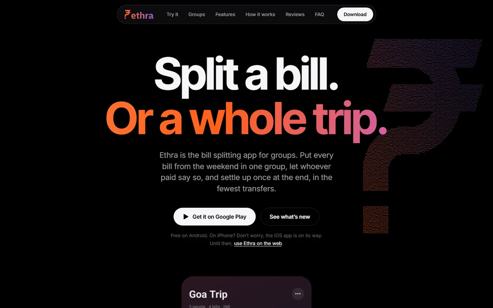
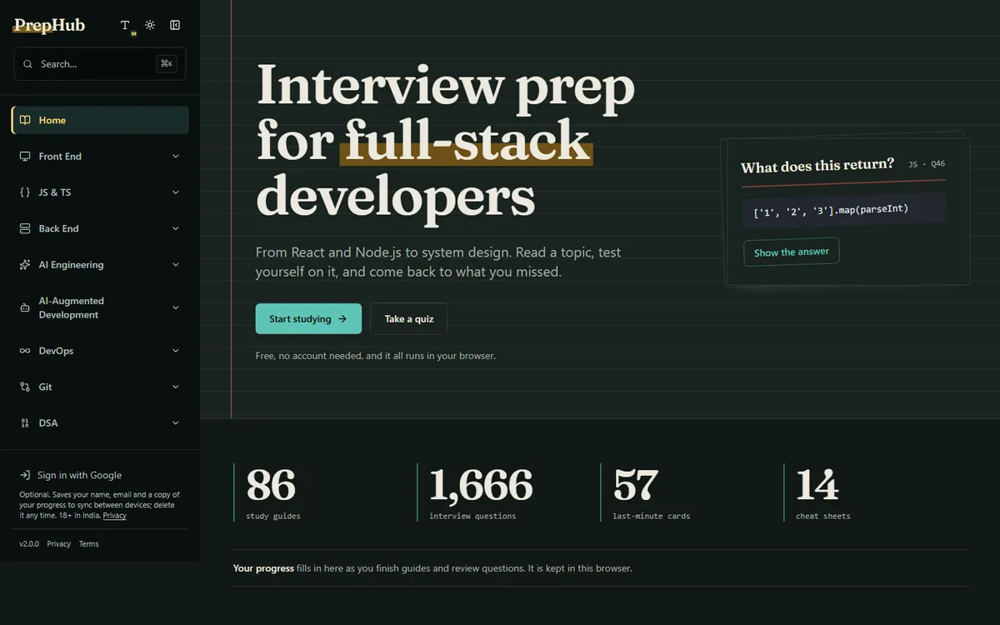
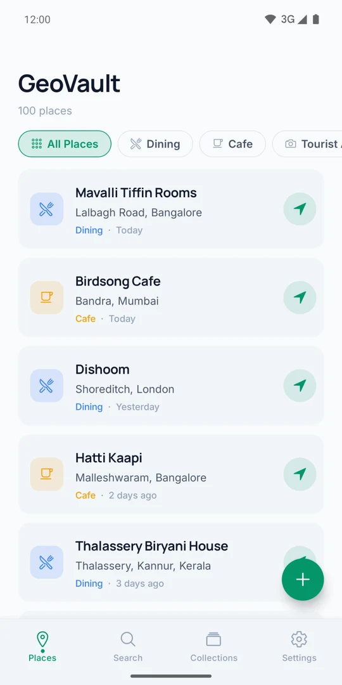
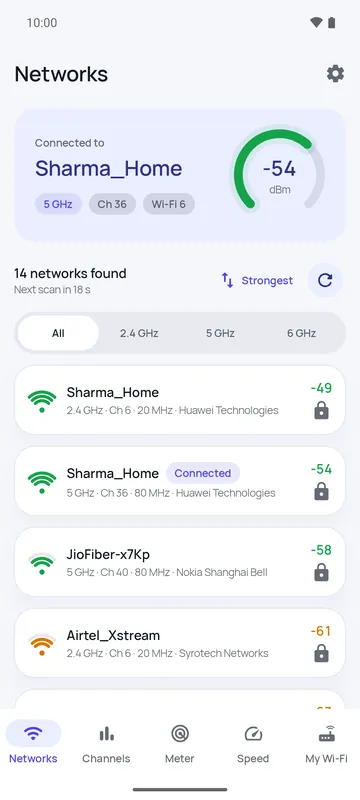
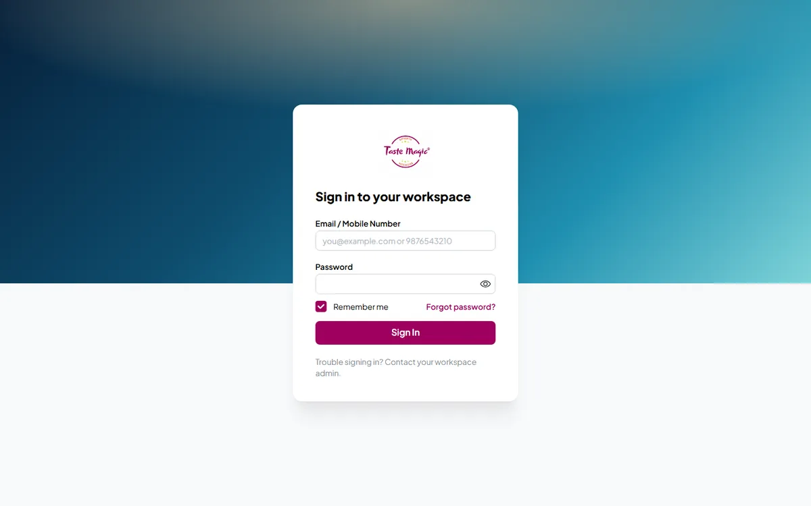
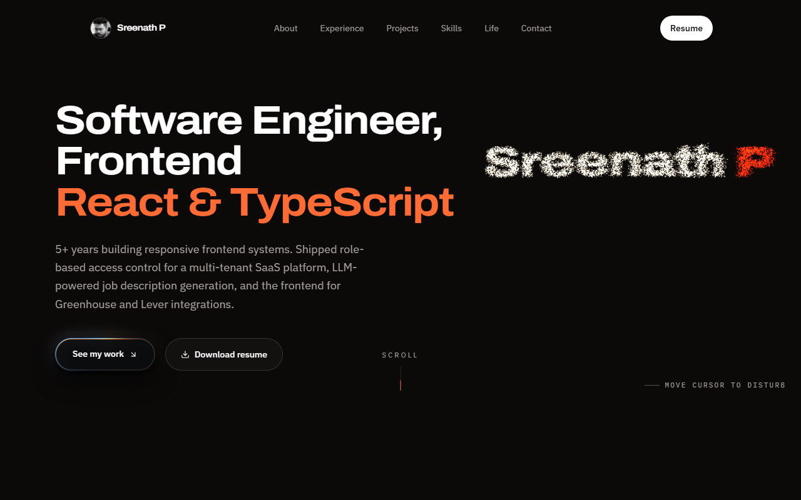

# Hi, I'm Sreenath

Frontend engineer with 5+ years building React and TypeScript products for B2B SaaS, from AI hiring tools to a Verizon retail platform. 
I care about clear UI, permission-aware systems and code that is easy to test.

### What I do

- **SaaS frontends**: multi-tenant apps with role-based access control and config-driven permissions, so new roles need no frontend changes.
- **AI product surfaces**: LLM-powered job description generation and review screens for multi-agent AI candidate scoring.
- **Billing and integrations**: Stripe Checkout and Billing Portal across 4 plan tiers, plus Greenhouse and Lever ATS integrations.
- **Quality and performance**: 80%+ test coverage with Jest and RTL, ~25% faster first load through code splitting, CI gates on every PR.

### Where I've worked

- **HASpaces** (2023 to 2026): frontend for Octagnt (AI hiring intelligence) and Skillkeepr (ATS). Led a Mantine and Node.js major-version upgrade across 3 repos, 100+ components, with no user-facing regressions. Mentored 2 junior developers.
- **Wipro for Verizon** (2020 to 2023): core contributor to Verizon Engage, a lead management SPA built from scratch for US retail representatives.

### Featured work

**[Ethra](https://ethraapp.com/)** · [Web app](https://app.ethraapp.com/) · [Google Play](https://play.google.com/store/apps/details?id=com.ethraapp.ethra) 
A bill-splitting app for groups, trips and flatmates, on Android and the web.

- Every bill from a trip in one group, including bills paid by more than one person.
- Settle up at the end in the fewest transfers, with a clear breakdown of who owes what and why.
- Split by item, units, shares, percentage or amount, with taxes, tips and discounts.
- Share summaries as a PDF or on WhatsApp.

`React Native` `Expo` `Web app` `PDF export`

 

**[PrepHub](https://prephub.sreenathp.com/)** · [Code](https://github.com/sreen98/prephub) 
An interview preparation platform with a study-notebook design: 86 guides, 1,666 interview questions and 162 coding challenges.

- Guides across frontend, backend, AI engineering, DevOps and system design.
- Quiz mode, spaced-repetition daily review and a timed interview simulator.
- JavaScript, TypeScript and React playgrounds in a VS Code editor, with graded challenges.

`React 19` `TypeScript` `Vite` `Tailwind CSS` `PWA`

**[GeoVault](https://play.google.com/store/apps/details?id=com.geovault.app)** · Android 
A private location notebook for travellers and foodies.

- Save places with notes, tags and nine categories, and group them into collections.
- Find them again with full-text search or by category, then open them in your maps app.
- Local-first, with no server and no tracking, plus optional scheduled Google Drive backups and JSON export.

`React Native` `Local-first` `Full-text search` `Google Drive backup`

**[Signalwise](https://play.google.com/store/apps/details?id=com.signalwise.app)** · Android, in closed testing 
An honest Wi-Fi analyzer with no ads, no subscription and no tracking.

- Nearby networks with signal, band, channel and security.
- Recommends the least crowded channel for your router.
- Live signal meter for finding dead zones.
- Speed test that shows whether the bottleneck is the Wi-Fi or the internet plan.
- Available in English and Hindi.

`Kotlin` `Jetpack Compose` `Offline` `M-Lab speed test`

**[AJ Homes](https://www.ajhomeslettings.co.uk/)** · Property agency website, UK 
Website for a Birmingham property agency covering sales, residential lettings and student lettings.

- Search by bedrooms, bathrooms and price.
- Property pages with photos and video.
- Enquiry forms.

`React` `Material UI` `Property search`

**Taste Magic** · Internal staff tool 
A multi-tenant PWA that helps an event-management team run a booking from first enquiry to finished event.

- Capture leads and plan each service: catering, photography, decoration, makeup and return gifts.
- Generate bills, track payments and coordinate vendors.
- Follow up with reminders and reviews, with a full audit trail.
- Branding comes from the API per tenant, never hardcoded.

`React` `Vite` `Mantine` `TanStack Query` `PWA`

**[sreenathp.com](https://sreenathp.com/)** · [Code](https://github.com/sreen98/portfolio) 
My portfolio, with an interactive hero and an animated photo stack, covering my work, projects and life outside code.

`React` `Three.js` `Framer Motion`

### Stack

`TypeScript` `React` `React Native` `Kotlin` `React Router` `Redux Toolkit` `Zustand` `TanStack Query` `Mantine` `Tailwind CSS` `Material UI` `Vite` `Jest` `Vitest` `React Testing Library` `Storybook` `GitHub Actions` `Node.js`

### Get in touch

Open to frontend roles and freelance work, and available to join immediately. Reach me on [LinkedIn](https://www.linkedin.com/in/sree-nath-p) or through [sreenathp.com](https://sreenathp.com).

<i>Shipping interfaces people can rely on.</i>

